# Tutor's Office — students, schedule and journal for a private tutor, for Sitebill

**EN** · A workspace for a private tutor built as an installable app for [Sitebill](https://sitebillcms.com/) (Community Edition): **student cards** (general, learning and admin info, statuses), **parent contacts**, subjects with course topics, a **schedule** (day / week / month / list, recurring lessons, reschedule with history, conflict check, working hours and holidays), a **lesson journal**, **homework** with statuses and overdue tracking, **payments with a balance and debts**, a **parent progress report** without private notes, and a rule-based **assistant**. Like [Content Manager](https://github.com/Sitebill/sitebill-app-content-manager) it **owns the whole site** (`shell.mode = "owner"`). Written end to end by an AI agent from a plain-text brief, using only the public instructions at [sitebillcms.com/llms.txt](https://sitebillcms.com/llms.txt).

**RU** · Рабочее место частного репетитора как устанавливаемое приложение для [Sitebill](https://www.sitebill.ru/) (Community Edition): **карточки учеников**, **контакты родителей**, предметы с темами курса, **расписание** (день / неделя / месяц / список, повторяющиеся занятия, перенос с историей, проверка конфликтов, рабочие часы и каникулы), **журнал занятий**, **домашние задания** со статусами и просрочкой, **оплаты с балансом и долгами**, **отчёт для родителей** без личных заметок и **ассистент** на правилах. Приложение **целиком владеет сайтом** (`shell.mode = "owner"`). Написано ИИ-агентом по текстовому ТЗ, по открытым инструкциям с [sitebillcms.com/llms.txt](https://sitebillcms.com/llms.txt).

| | |
|---|---|
| 🌍 International | https://sitebillcms.com/ |
| 🇷🇺 Россия и СНГ | https://www.sitebill.ru/ |
| 🧰 App SDK | https://github.com/Sitebill/sitebill-app-sdk |
| 🚀 Starter | https://github.com/Sitebill/sitebill-app-starter |
| 📚 More examples | https://github.com/Sitebill/sitebill-app-content-manager · https://github.com/Sitebill/sitebill-app-personal-finance |
| 🛒 Marketplace | https://sitebillcms.com/apps/rumantic.tutor |

## What you get / Что внутри

- **Overview** — lessons today and this week, active students, value of lessons held this month, total debt; today's lessons with a one-click “done”, the next 7 days, assistant recommendations.
- **Students** — a card with tabs: *profile* (name, grade, school, contacts, subject, format, price, goal, level, desired result, strengths, weaknesses, topics to work on, wishes, **private notes**), *parents* (several contacts per student), *lessons*, *journal*, *homework*, *payments*, *report*. Statuses: new / active / paused / finished / archived. Balance, lessons held and paid, next and last lesson are calculated.
- **Schedule** — day, week, month and list views; **drag a lesson** to another slot to reschedule it; recurring lessons (weekly series); when the last lesson of a series is done, **the next one is created automatically**. Statuses: planned, confirmed, done, cancelled by tutor, cancelled by student, no-show, rescheduled. Every reschedule is written to a **history**. A **conflict check** flags overlaps, days off, holidays and hours outside the working time; the free-slot finder suggests alternatives.
- **Lesson journal** — topic, material, exercises, results, difficulties, what was assigned, a score, links; search by topic and filter by date and student.
- **Homework** — issued / in progress / submitted / done / checked / rework, and **overdue** (calculated), with a filter and an “AI draft” button.
- **Payments** — payments per student, a balance (payments − charged lessons; done lessons and no-shows are charged, cancellations are not), who owes what, money received and earned in the month.
- **Parent report** — a ready text with topics covered, attendance, scores and homework for a period. **Private notes are never included**; money only if you ask for it.
- **Assistant** — rule based, runs **inside the platform, with no external AI service**: debts, lessons without a journal entry, overdue and waiting-for-check homework, students without a next lesson or silent for 2+ weeks, unconfirmed lessons for today/tomorrow, overlaps, weak recent scores; a **homework draft** (an honest structure template built from the topic, the student's weak spots and recent difficulties — not ready-made tasks); a **free-slot finder**. It never changes data by itself.
- **Subjects and settings** — subjects with price, programme, ordered course topics and colour; working days and hours, default price and duration, holidays, your name.
- **One-click sample data** — four subjects, six students with parents, lessons for several weeks, journal entries, homework in different states, payments (and one debtor).
- **4 languages** — ru, en, sr, tg (275 identical keys each). *sr and tg are machine translations — native review is welcome.* Assistant texts are in ru and en (sr / tg fall back to en).
- **Light and dark theme**, mobile friendly layout.
- **Privacy by design** — every operation is `@guard` + `@can(admin, Tenant)`; every row carries `tenant_id`; the platform's `AppModel` scopes it automatically.

### What is deliberately *not* here

- A **parent login cabinet** — parents get a copy-paste progress report instead (the brief's “parent cabinet without private notes” is covered by the report, not by a separate login).
- **Voice commands**, file storage for attachments (journal and homework hold **links** only), integrations (calendars, messengers, video calls), notifications and reminders, PDF/Excel reports, a real LLM.
- The **payments** module is an addition to the brief — it makes the “debt” hints possible.

The assistant is a set of transparent rules — honest about what it is.

## Screenshots

| | |
|---|---|
| 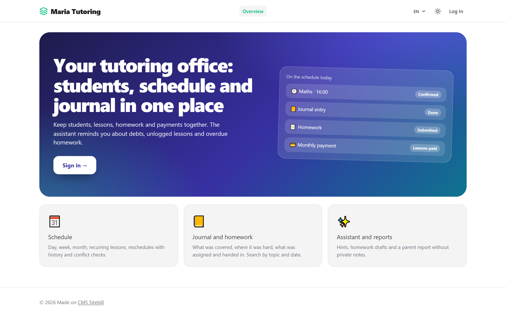 **Landing for guests** | 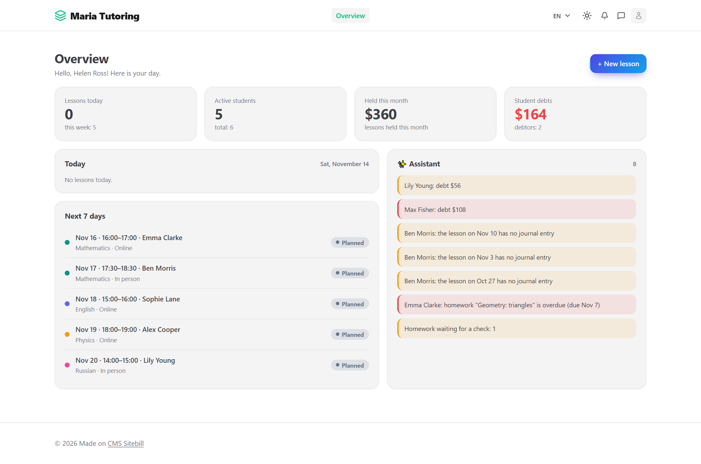 **Overview** |
| 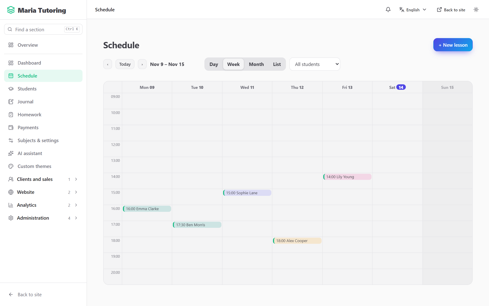 **Schedule — week** | 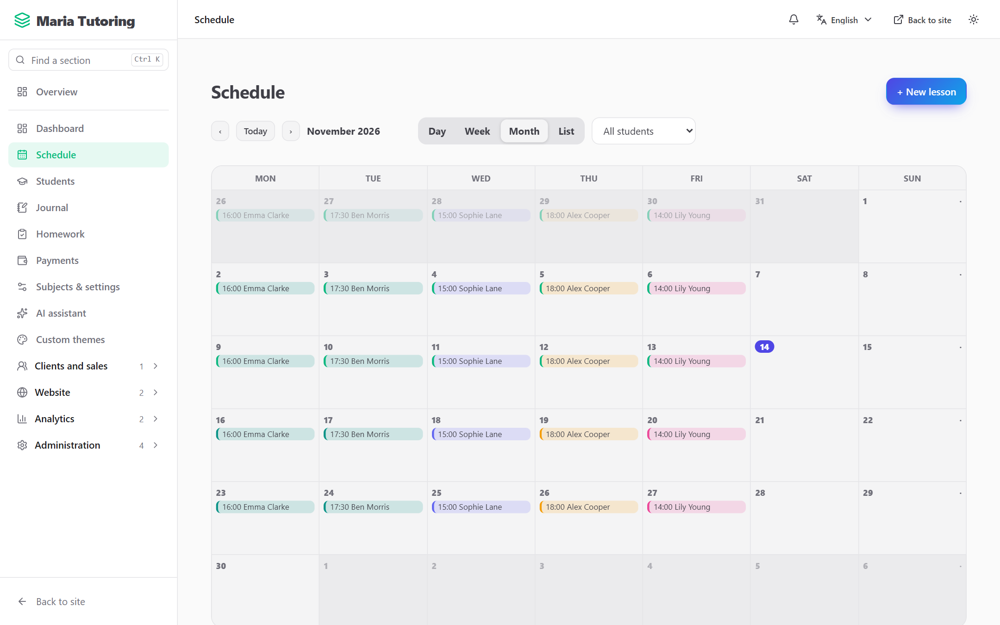 **Schedule — month** |
| 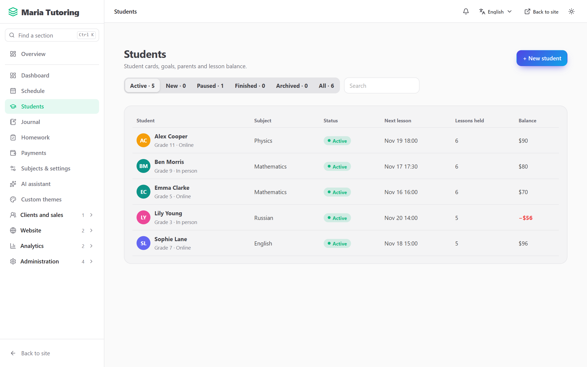 **Students** | 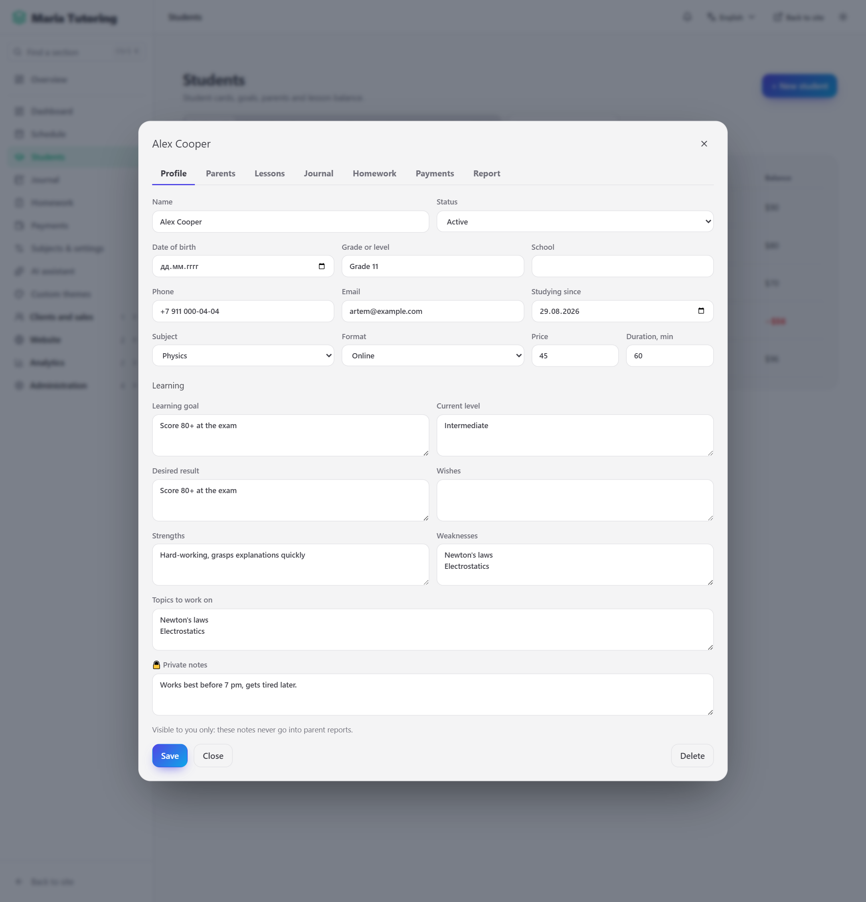 **Student card** |
| 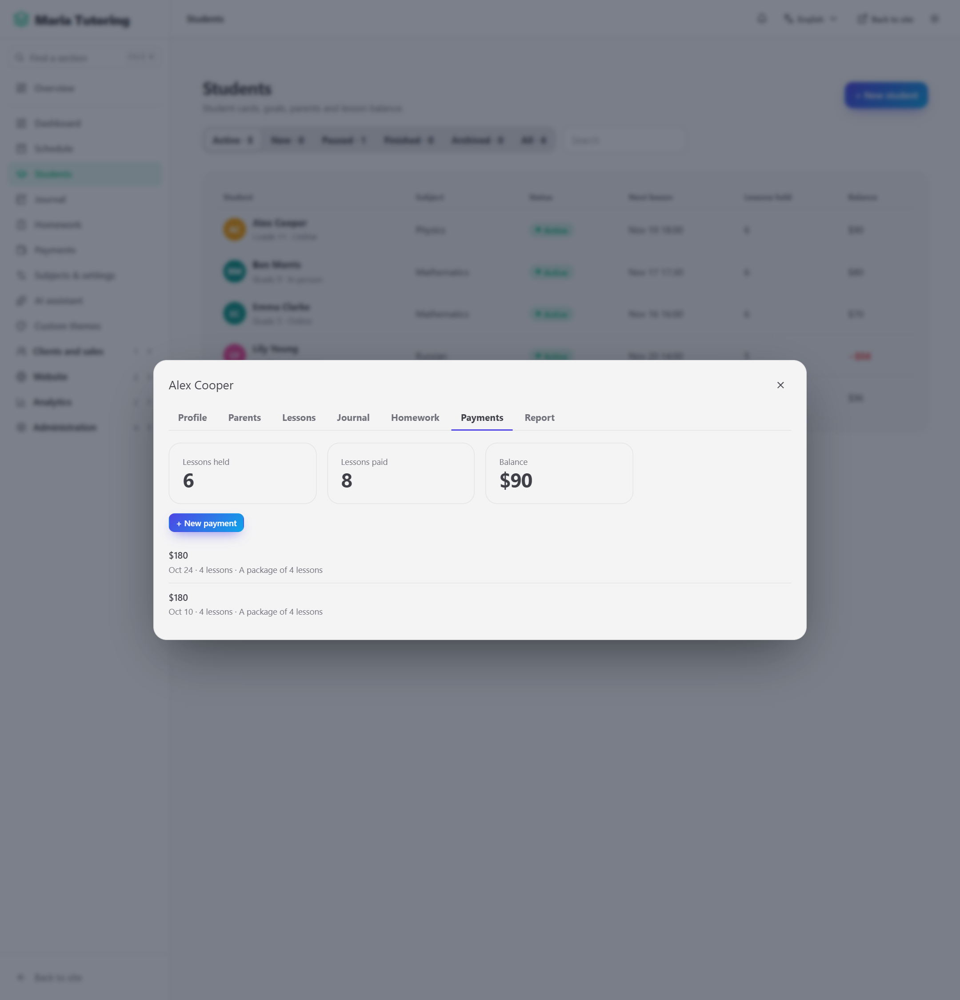 **Student: payments** | 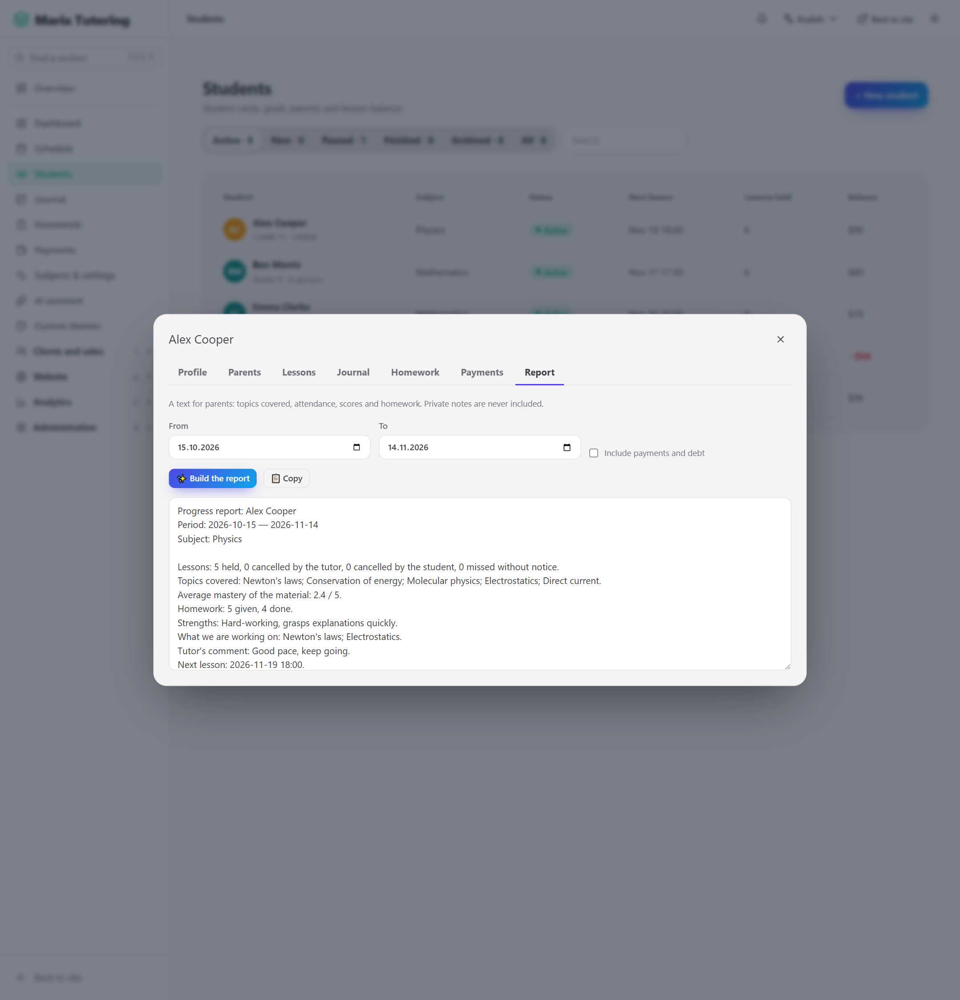 **Parent report** |
| 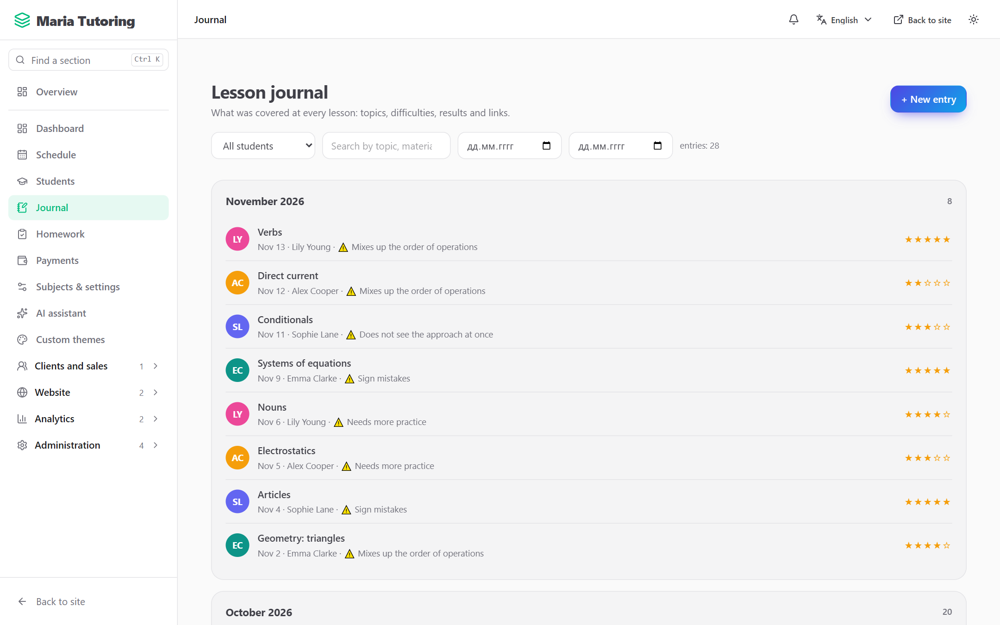 **Lesson journal** | 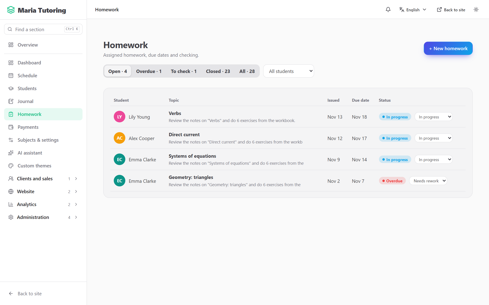 **Homework** |
| 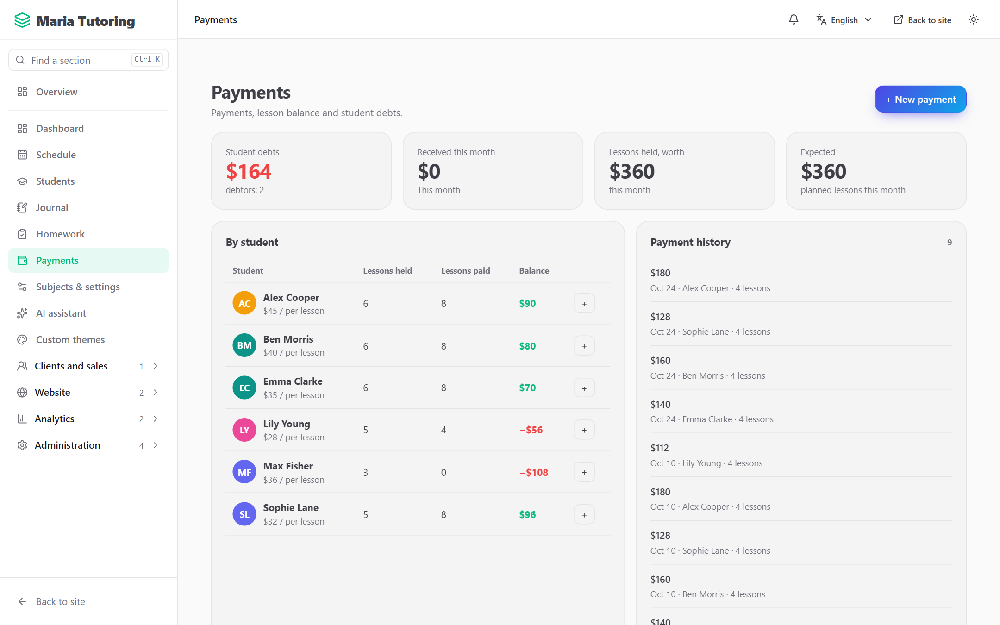 **Payments and debts** | 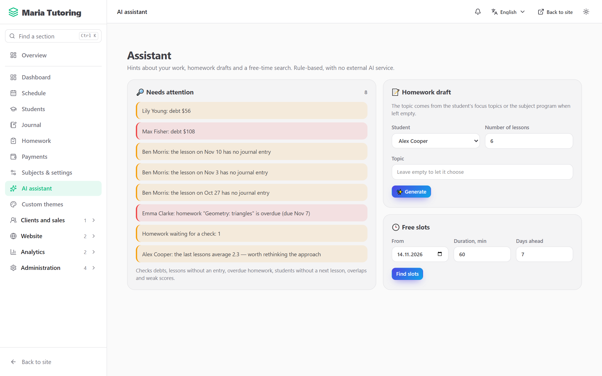 **Assistant** |
| 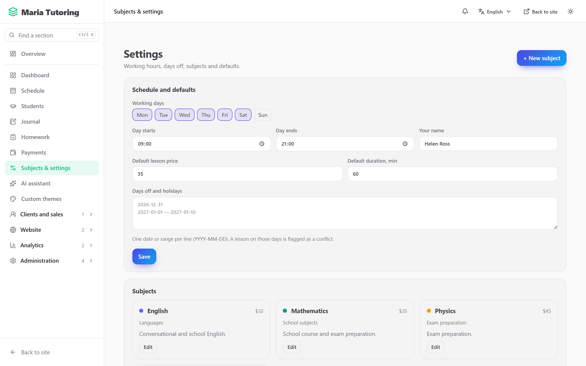 **Subjects and settings** | 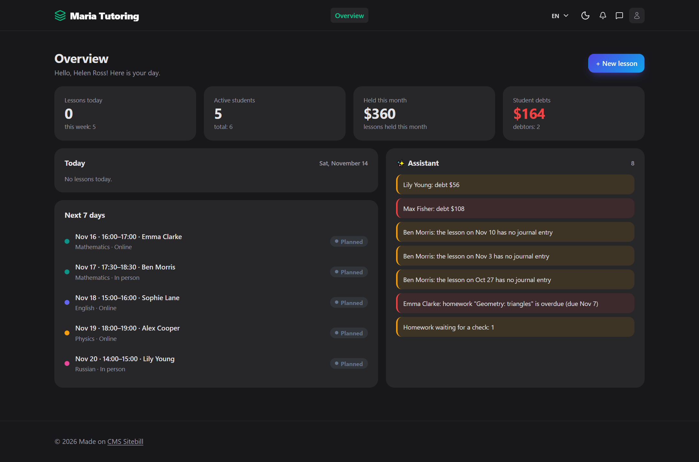 **Dark theme** |

## Install / Установка

### 1. A clean instance with Docker (recommended)

`--profile blank` installs the platform **without the real-estate demo**:

```bash
curl -fsSL https://sitebillcms.com/install.sh | sh -s -- --profile blank --json
```

Then, from the platform directory:

```bash
# build the package (see "Build") or download rumantic.tutor-1.0.0.sbapp from Releases
docker compose cp rumantic.tutor-1.0.0.sbapp api:/tmp/app.sbapp
docker compose exec api php artisan apps install /tmp/app.sbapp --shell
```

`--shell` lets the app take over the home page and menus. Open the site, sign in as the admin and press **“Load demo data”**.

> Unsigned packages need `APPS_ALLOW_UNSIGNED=true` (the default of Community installs made by `install.sh`).
> Windows + Git Bash: do **not** export `MSYS_NO_PATHCONV=1` globally — set it on a single command.

### 2. Admin panel

**Apps → Installed apps → Upload your own package** → choose the `.sbapp`.

### 3. Update / remove

```bash
docker compose exec api php artisan apps install /tmp/app.sbapp --force
docker compose exec api php artisan apps remove rumantic.tutor --with-data   # drops the tables too
```

Reinstalling with `--force` keeps your data. Browsers cache the app's ES modules by version: hard-reload or bump `version` when iterating.

## Build / Сборка

No bundler, no `npm install` — the web part is plain ESM that uses the Vue of the host.

```bash
npm i -g @sitebill/app-sdk
sitebill-app check     # manifest, PHP syntax, GraphQL guards, locales, widgets
sitebill-app pack      # → rumantic.tutor-1.0.0.sbapp
```

## How it is built / Как устроено

```
manifest.json                              id, shell (owner), admin menu & pages, profiles
composer.json                              PSR-4 SitebillApps\Lumen\Tutor\ → api/src
api/
  src/TutorServiceProvider                 registers GraphQL schema + migrations through the SDK
  src/Models/{Subject,Student,Guardian,Lesson,LessonMove,Entry,Homework,Payment,Setting}   AppModel (automatic tenant scope)
  src/GraphQL/TutorResolver                CRUD, series, reschedule, assistant endpoints, demo seeder
  src/Services/Ledger                      balance and debt (single source of truth for money)
  src/Services/Schedule                    conflicts and free slots
  src/Services/TutorAgent                  the rule-based assistant: review / homework draft / parent report
  src/Services/Settings                    working hours, defaults, holidays
  src/Services/DemoData                    sample data (ru / en)
  graphql/schema.graphql                   all under @guard @can(admin, Tenant)
  database/migrations/                     tables app_rumantic_tutor_*
web/
  core.mjs                                 CSS, constants, helpers, GraphQL documents, office store, small components
  lessons.mjs                              lesson card, schedule (day / week / month / list, drag & drop)
  work.mjs                                 journal, homework, payments
  students.mjs                             students list and the student card
  pages.mjs                                overview, settings, assistant, dashboard widget
  admin.mjs / site.mjs                     admin pages + widget / site home (landing for guests)
locales/{ru,en,sr,tg}.json                 UI strings
test/smoke.mjs                             jsdom smoke test: mounts every page against a fake host
```

### Data model

| Table | Essentials |
|---|---|
| `…_subjects` | name, category, programme, ordered topics, price, colour |
| `…_students` | profile, learning info, status, private notes, subject, format, price |
| `…_guardians` | student, name, relation, phone, email |
| `…_lessons` | student, subject, date, time, duration, format, price, status, `series_id` |
| `…_lesson_moves` | reschedule history: from → to, note |
| `…_entries` | journal: topic, material, exercises, results, difficulties, score, links |
| `…_homework` | topic, text, issued / due dates, status, comment, links |
| `…_payments` | student, date, amount, lessons count, note |
| `…_settings` | per-tenant key / value (working time, holidays, defaults) |

### GraphQL API (admin only)

| Operation | Purpose |
|---|---|
| `tutorSubjects`, `tutorStudents`, `tutorGuardians`, `tutorLessons`, `tutorLessonMoves`, `tutorEntries`, `tutorHomework`, `tutorPayments`, `tutorSettings` | lists |
| `tutorSave…` / `tutorDelete…` | create (no `id`) or update (with `id`) / delete |
| `tutorSetLessonStatus`, `tutorRescheduleLesson` | status (series continue automatically) and reschedule with history |
| `tutorConflicts`, `tutorFreeSlots` | schedule checks |
| `tutorReview`, `tutorHomeworkDraft`, `tutorProgressReport` | the assistant (read-only: it proposes, you save) |
| `tutorSeedDemo` | fills an **empty** workspace with sample data |

### Test

```bash
mkdir /tmp/nm && cd /tmp/nm && npm i vue jsdom
node test/smoke.mjs /tmp/nm      # 23 scenarios: every page, cards, tabs, denied access
```

Against a running instance the backend was also checked with 48 live GraphQL requests (series and automatic next lesson, reschedule history, conflicts, balance and debt rules, validation, tenant guards).

---

# По-русски

## Что это

Приложение ставится поверх Sitebill и **заменяет весь сайт**: гость видит главную-лендинг, администратор — кабинет репетитора: обзор, расписание, ученики, журнал занятий, домашние задания, оплаты, настройки и вкладка «Помощник».

Что есть: карточка ученика (анкета, учебная информация, **личные заметки**, статусы), контакты родителей, расписание в четырёх видах с переносом перетаскиванием, повторяющиеся занятия (следующее создаётся само, когда проведено последнее), история переносов, проверка конфликтов (пересечения, выходные, каникулы, нерабочие часы), поиск свободных окон, журнал занятий с поиском, домашние задания с просрочкой, оплаты с балансом и долгами, отчёт для родителей **без личных заметок**.

**Помощник работает по правилам, без внешних ИИ-сервисов**: долги, занятия без записи в журнале, просроченные и ожидающие проверки задания, ученики без следующего занятия, пересечения, слабые оценки; **черновик домашнего задания** — честный шаблон структуры по теме и слабым местам ученика (не готовые задачи); поиск свободных окон. Сам данные не меняет.

Не реализованы: **отдельный кабинет родителя со входом** (вместо него — отчёт, который можно скопировать), голосовые команды, хранение файлов (в журнале и заданиях — только ссылки), интеграции, уведомления, отчёты PDF/Excel, настоящая LLM. Модуль оплат — дополнение к ТЗ. Переводы sr и tg — машинные.

## Быстрый старт

```bash
curl -fsSL https://sitebillcms.com/install.sh | sh -s -- --profile blank --json
docker compose cp rumantic.tutor-1.0.0.sbapp api:/tmp/app.sbapp
docker compose exec api php artisan apps install /tmp/app.sbapp --shell
```

Зайдите администратором и нажмите «Загрузить демо-данные»: четыре предмета, шесть учеников с родителями, занятия за несколько недель, записи журнала, задания, оплаты. Пакет собирается `sitebill-app check` → `sitebill-app pack`; сборщика нет — веб-часть это обычные ES-модули на Vue платформы.

## Лицензия

MIT — см. [LICENSE](LICENSE). © Sitebill — [sitebillcms.com](https://sitebillcms.com/) · [sitebill.ru](https://www.sitebill.ru/)
